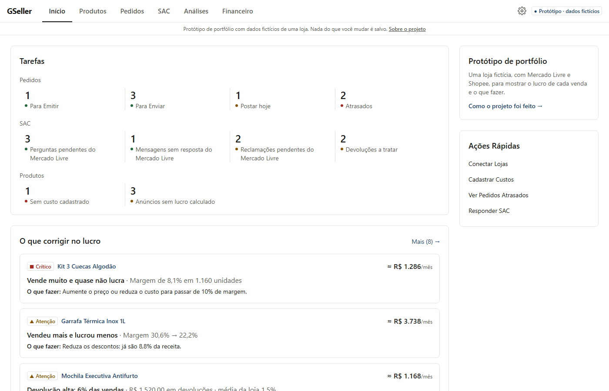
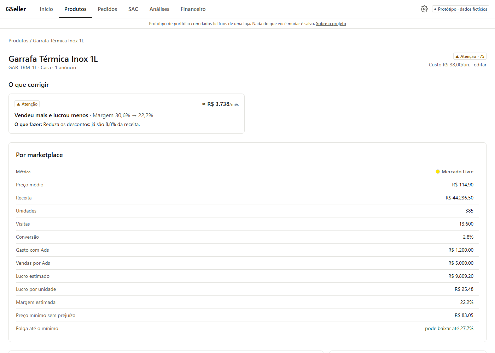
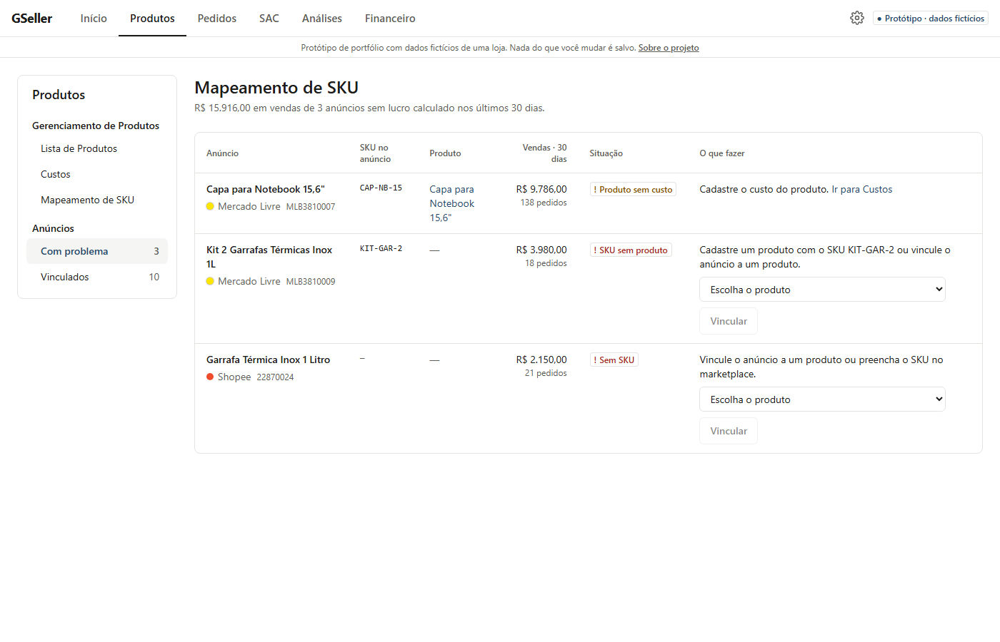
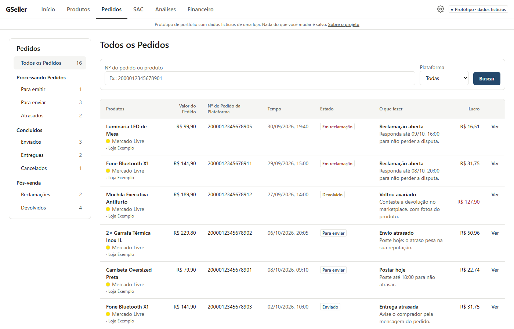
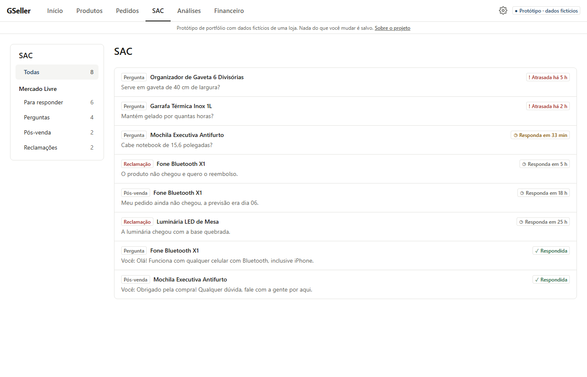
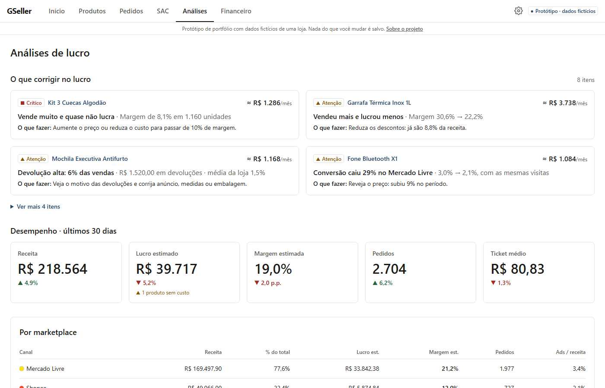
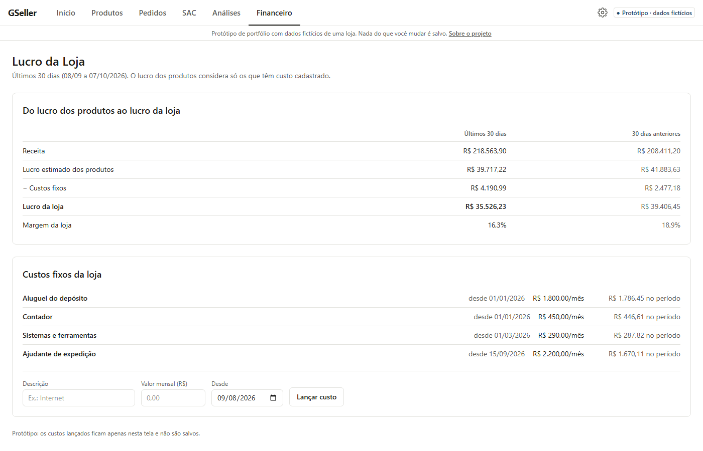

# GSeller

**O UpSeller mostra o pedido. O GSeller mostra quanto ele deu de lucro e o que fazer.**

Protótipo de portfólio de um painel para quem vende no Mercado Livre e na Shopee. Ele mostra o lucro de cada produto, pedido e anúncio, já descontados comissão, frete, Ads, devolução, imposto e custo, e diz o que corrigir. Todos os dados são fictícios.

**Abra a demonstração:** https://g-seller.vercel.app



## Rodar localmente

Precisa de Node.js 24.

```bash
cd frontend
npm install && npm run dev
```

Abra http://localhost:3000. Não precisa de banco, conta nem chave: o app abre direto na loja fictícia, e nada do que você muda é salvo.

## Como foi feito

O UpSeller é a ferramenta mais usada pelos sellers com quem conversei. Antes de construir, mapeei o produto com a ferramenta de engenharia reversa [REA](https://github.com/morluto/rea), de forma passiva e só com o que chega ao navegador, usando a minha própria conta:

- 514 rotas de tela;
- 1.979 chamadas de API do frontend;
- 12 telas observadas com a conta logada.

O mapa mostrou que o UpSeller é, antes de tudo, um ERP fiscal e de anúncios. O lucro dele sai no dia seguinte, sem o imposto do CNPJ e sem dizer o que fazer. Daí o recorte do GSeller:

- copiar a organização das telas e o vocabulário que o seller já conhece;
- entregar o lucro com imposto, no dia, e com a ação a tomar.

Nada de código, imagem ou marca do UpSeller entrou no projeto. O mapa completo está no Bloco 61 do [Master Plan](MASTER_PLAN_SAAS_MARKETPLACE_MVP.md).

## O que tem no protótipo

| Módulo | O que mostra |
|---|---|
| **Início** | Tarefas do dia por módulo, o que corrigir no lucro e vendas por canal |
| **Produtos** | Lucro, margem e saúde de cada produto, por marketplace, com o **preço mínimo sem prejuízo** |
| **Mapeamento de SKU** | Anúncios que vendem sem lucro calculado (sem SKU, SKU sem produto, produto sem custo) e como resolver |
| **Custos** | Custo do produto com vigência: alterar cria uma versão nova, o passado não muda |
| **Pedidos** | Do pagamento à entrega ou devolução, com prazo, o que fazer e o lucro do pedido |
| **SAC** | Perguntas, mensagens e reclamações com prazo de resposta e trava de contato fora da plataforma |
| **Análises** | Alertas de lucro, comparação por marketplace e quem mais lucra |
| **Financeiro** | Lucro da loja depois dos custos fixos (aluguel, contador, equipe), com vigência por data |

| | |
|---|---|
|  |  |
|  |  |
|  |  |

## Regras de dinheiro testadas

Cada regra é uma função pura em `frontend/src/lib/demo/`, com testes de valores conferidos à mão:

- `economics.ts`: lucro estimado de cada anúncio (comissão, tarifa, frete, Ads, devolução, custo e imposto);
- `min-price.ts`: preço em que o lucro da unidade chega a zero;
- `fixed-costs.ts`: custo fixo do período por dias de calendário e vigência;
- `mapping.ts`: vínculo do anúncio ao produto (manual antes do SKU, SKU do produto ou da variante);
- `orders.ts`: o que fazer em cada pedido, por ordem de urgência, e o custo de cada devolução;
- `rules.ts`: alertas de lucro, como "vendeu mais e lucrou menos" ou "devolução alta".

Sem custo cadastrado, o app não mostra lucro: nenhum número é inventado.

```bash
cd frontend
npm test            # testes
npm run check       # lint e formatação (Biome)
npm run typecheck   # tipos
npm run knip        # código e dependências sem uso
```

## Estrutura

```text
.
├── frontend/           Next.js (App Router, TypeScript, Tailwind): o protótipo
├── backend/            API FastAPI com isolamento por conta (RLS); fora do protótipo
├── infra/postgres/     Roles e bancos do backend
├── docs/prints/        Prints das telas
└── MASTER_PLAN_SAAS_MARKETPLACE_MVP.md   Decisões de produto e arquitetura
```

## Fora do protótipo

Login (Supabase), cobrança (Stripe), e-mails (Resend) e o backend com contas, empresas e lojas foram construídos antes de o projeto virar protótipo de portfólio. O código continua no repositório, mas o app não usa nada disso: as telas que dependem de conta levam ao Início. A integração real com o Mercado Livre e a Shopee não foi feita.

Para rodar o backend:

```bash
docker compose up -d            # PostgreSQL na porta 5440, só em 127.0.0.1
cd backend
cp .env.example .env            # preencha ENCRYPTION_KEY (comando no arquivo)
uv sync && uv run alembic upgrade head
uv run uvicorn app.main:app --reload
uv run pytest -q
```

## Regras de segurança do repositório

- Nunca versionar `.env`, só os arquivos `.env.example`.
- Segredos existem só no backend. O build do frontend falha se uma variável `NEXT_PUBLIC_*` tiver nome de segredo.
- A API conecta ao banco com a role `app_runtime` (sem DDL, sem BYPASSRLS), e as migrations usam `app_migrator`. Os testes em `backend/tests/test_db_privileges.py` garantem essa separação.
- Logs são JSON e passam por mascaramento de tokens, segredos e credenciais.
